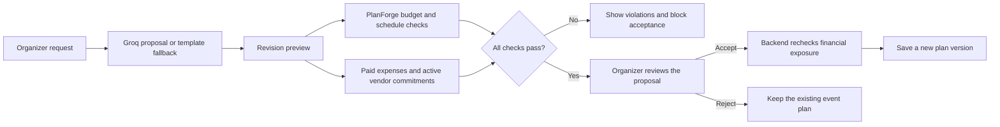
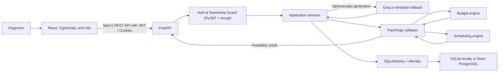

<div align="center">
  <h1>Aventra</h1>
  <p><strong>Powered by PlanForge</strong></p>
  <p><em>Every event, intelligently orchestrated.</em></p>
  <p>
    An event-planning workspace for turning event details into organized tasks, budgets, vendor records, and schedules—with deterministic checks before a revised plan is applied.
  </p>
  <p>
    
    
    
    
    
    
    
  </p>
</div>

## Product preview

The interface uses an understated cream, forest-green, and mint palette. These screenshots show the current application.

**Live demo:** [https://aventra-mocha.vercel.app](https://aventra-mocha.vercel.app/)

<p align="center">
  
</p>
<p align="center"><em>Landing page · Aventra's event-planning workspace</em></p>

<table>
  <tr>
    <td width="50%" align="center">
      
      <br><strong>Dashboard</strong>
    </td>
    <td width="50%" align="center">
      
      <br><strong>Timeline &amp; milestones</strong>
    </td>
  </tr>
  <tr>
    <td width="50%" align="center">
      
      <br><strong>Budget management</strong>
    </td>
    <td width="50%" align="center">
      
      <br><strong>Vendor checklist</strong>
    </td>
  </tr>
</table>

<p align="center">
  
</p>
<p align="center"><em>AI Workspace · preview a proposed revision before deciding whether to apply it</em></p>

The **My Events** and **Tasks** pages are implemented, but screenshots for those pages were not supplied and are not represented here.

## Why Aventra?

Planning an event means coordinating dates, people, tasks, costs, and vendors—often across separate tools. Aventra brings those records into one event workspace. It helps organizers track what is planned and committed, while **PlanForge** checks budget and schedule constraints instead of leaving feasibility entirely to a language model.

## What is implemented

- **User authentication & session management** — self-service user signup, login, and logout powered by FastAPI, PyJWT, and bcrypt password hashing. Supports HttpOnly/SameSite cookies with an in-memory Bearer token fallback; the `Secure` cookie flag is configurable and enabled for the configured HTTPS deployment.
- **Multi-user event isolation** — backend ownership checks restrict authenticated organizers to their own events and event-related tasks, budgets, expenses, vendors, and replan proposals. Unauthenticated requests return `401 Unauthorized`; inaccessible events return `404 Not Found`, avoiding disclosure of whether a foreign event exists.
- **Event creation and management** — create, view, update, and delete events; capture event details and generate a proposed baseline plan. Groq-powered generation is optional; a deterministic template fallback is available without it.
- **Dashboard and My Events** — review event information and navigate between events and planning areas.
- **Task management** — create and update tasks, including status, duration, deadlines, priorities, milestones, assignees, and dependencies.
- **Timeline** — inspect task ordering, milestone status, dependencies, and schedule conflicts.
- **Budget management** — manage budget categories and line-item expenses, including estimated and actual costs and payment status.
- **Vendor checklist** — manually track vendor details, estimated costs, and booking status. This is an organizer-maintained checklist, not a vendor marketplace or matching system.
- **AI-assisted replanning** — request proposed budget, date, or guest-count changes in natural language; review a preview and feasibility details; then accept or reject.
- **Plan history** — accepted revisions are saved as plan versions with feasibility details and a change summary.
- **Constraint-aware acceptance** — infeasible previews are blocked, and the backend acceptance endpoint independently rechecks existing financial exposure before applying a revision.

## Authentication and user isolation

Aventra implements user authentication and backend event-ownership checks:

### Architecture & Security Flow

- **Registration (`POST /api/v1/auth/register`)**: Validates and normalizes the email format, requires a name field, enforces unique accounts, and hashes passwords with `bcrypt` before persisting them.
- **Authentication (`POST /api/v1/auth/login`)**: Verifies credentials against the stored bcrypt password hash and issues a signed JSON Web Token (JWT) using `PyJWT` with the HS256 signing algorithm. The token is returned in the response payload and set in an `HttpOnly` cookie. `SameSite` and `Secure` behavior are configurable; the deployment configuration enables `Secure` for HTTPS and uses `SameSite=None` for the cross-site frontend/backend setup.
- **Session Verification & Logout (`GET /api/v1/auth/me`, `POST /api/v1/auth/logout`)**: Validates active tokens, exposes the authenticated organizer's profile, and flushes session cookies upon sign-out.
- **Dual Credential Resolution**: The backend accepts an `access_token` cookie or an `Authorization: Bearer <token>` header.

### Ownership Enforcement & Data Isolation

- **Route Guarding**: All event-management endpoints require an authenticated user via FastAPI's `current_user: User = Depends(get_current_user)` dependency.
- **Sub-resource Ownership Checks**: Event-related endpoints verify event ownership before reading or changing that event's tasks, budget, expenses, vendors, timeline dependencies, or replan proposals.
- **Non-disclosing Event Responses**: Requests for inaccessible events return `404 Not Found` rather than identifying whether an event belongs to another account.
- **Legacy Record Handling**: Events without an owner are excluded from authenticated event listings and cannot be accessed through owner-checked event endpoints.
- **Client Route Protection**: The landing page remains publicly accessible. Workspace routes (`/events`, `/dashboard`, `/budget`, `/timeline`, `/tasks`, `/vendors`, `/ai-workspace`, `/settings`) are wrapped in `ProtectedRoute`, automatically prompting unauthenticated visitors to sign in or create an account via the modal dialog.

### PostgreSQL Schema & Alembic Migrations

- **`users` Table**: Contains `id` (UUID Primary Key), `email` (unique index), `name`, `hashed_password`, and timestamp columns (`created_at`, `updated_at`).
- **`events.user_id` Foreign Key**: Binds each event to its owner (`FOREIGN KEY (user_id) REFERENCES users (id) ON DELETE CASCADE`) with an indexed column for query performance.
- **Repeatable Migrations**: Managed via **Alembic** (`backend/alembic/versions/001_add_users_and_event_user_id.py`). Supports Neon PostgreSQL transactional DDL in production as well as SQLite batch operations for local development and test runs.

## PlanForge: deterministic checks around proposed plans

PlanForge is Aventra's Python constraint-validation layer. Groq can interpret a planning request and return a structured proposal; PlanForge evaluates applicable budget and schedule conditions before that proposal is presented for acceptance.

### Implemented checks

| Area | What is checked |
| --- | --- |
| Budget allocations | Allocations are evaluated against the total budget. Mandatory and fixed items are preserved; variable allocations may be scaled within the available amount. Infeasible mandatory/fixed requirements report a shortfall. |
| Task scheduling | Task dependencies are ordered topologically. Circular dependencies, impossible task deadlines, and tasks that finish after the event date are reported as schedule conflicts. |
| Existing financial exposure during replanning | The proposed budget must cover paid expenses and estimated costs for vendors in `booked` or `confirmed` status. Other vendor statuses, including `cancelled`, are excluded from active commitments. |
| Revision acceptance | A preview marked infeasible cannot be accepted. Acceptance checks financial exposure again on the backend; event data is only updated for an accepted revision. |

**Guest-count limitation:** guest count can be included in a revision preview and applied when accepted, but Aventra does not currently validate guest count against venue capacity, catering limits, or another guest-count constraint. Passing the implemented checks is not a guarantee that every real-world event requirement is satisfied.

### Replanning workflow



## How it works

1. **Sign up or log in** to create an organizer profile.
2. **Create an event** and enter its planning details.
3. **Organize the plan** by managing tasks, dependencies, budget categories, expenses, vendors, and schedule.
4. **Request a revision** in the AI Workspace, such as a budget or date change.
5. **Review the preview** and the deterministic PlanForge feasibility result.
6. **Accept or reject** the proposal. Infeasible revisions are blocked; accepted revisions are saved as a new plan version.

## System architecture



The frontend interacts with the `/api/v1` API using session cookies and in-memory tokens. FastAPI routes authenticate requests and verify event ownership before delegating to application services and SQLAlchemy models. PlanForge performs deterministic validation in the backend; Groq is an optional proposal-generation service, not the source of feasibility decisions.

## Technology

| Layer | Technologies |
| --- | --- |
| Frontend | React 19, TypeScript, Vite, Tailwind CSS v4, React Router, Recharts, Lucide |
| Backend | Python, FastAPI, Pydantic, SQLAlchemy |
| Authentication & Security | PyJWT (HS256 tokens), bcrypt password hashing, HttpOnly/SameSite session cookies, backend ownership verification |
| Planning | PlanForge validators; Google OR-Tools for budget allocation, Aventra's deterministic dependency and deadline analysis for scheduling |
| Database & Migrations | Neon PostgreSQL (production) through psycopg, SQLite (local development), Alembic schema migrations |
| AI | Groq API using the official Python SDK; deterministic template fallback |
| Testing | Pytest, FastAPI TestClient (73 backend tests in the latest verified run) |
| Deployment configuration | Vercel frontend, Render web service, Neon PostgreSQL — prepared, not deployed |

## Getting started

### Prerequisites

- Python 3.10 or newer (Python 3.12 recommended for OR-Tools compatibility)
- Node.js 20.19+ or 22.12+ and npm (Vite 8-compatible versions)

### 1. Clone the repository

```bash
git clone https://github.com/sruthi-r-22/aventra.git
cd aventra
```

### 2. Set up the backend

Create and activate a virtual environment, then install the backend requirements:

```bash
cd backend
python -m venv .venv
```

PowerShell:

```powershell
.\.venv\Scripts\Activate.ps1
python -m pip install -r requirements.txt
Copy-Item ..\.env.example .env
```

macOS/Linux:

```bash
source .venv/bin/activate
python -m pip install -r requirements.txt
cp ../.env.example .env
```

Edit `backend/.env` to configure your environment variables:

```dotenv
GROQ_API_KEY=your_groq_api_key_here
DATABASE_URL=sqlite:///./aventra.db
CORS_ORIGINS=http://localhost:5173,http://localhost:3000

# Authentication and security configuration
JWT_SECRET_KEY=your_secure_random_jwt_secret_here
JWT_ALGORITHM=HS256
ACCESS_TOKEN_EXPIRE_MINUTES=1440
COOKIE_SECURE=false
COOKIE_SAMESITE=lax
```

These values are local-development examples. Do not commit `.env` files, real API keys, JWT secrets, or production database credentials. Deployed environments should use a strong, unique `JWT_SECRET_KEY` rather than the development default.

Apply database migrations:

```bash
alembic upgrade head
```

This applies the Alembic migration to create the `users` table and the `events.user_id` foreign key. The backend defaults to SQLite (`backend/aventra.db`) when run locally. If `GROQ_API_KEY` is not configured, planning uses the deterministic fallback templates. Never commit `.env` or real credentials.

Start the API from `backend/`:

```bash
python -m uvicorn app.main:app --host 127.0.0.1 --port 8000 --reload
```

- API documentation: <http://localhost:8000/api/docs>
- Health check: <http://localhost:8000/api/health>

### 3. Set up the frontend

In a second terminal, from the repository root:

```bash
cd frontend
npm ci
npm run dev
```

Open <http://localhost:5173>. For local development, leave `VITE_API_URL` unset or blank; Vite's existing `/api` proxy targets the local backend. For a separate backend origin, set `VITE_API_URL` to the origin only; the client appends `/api/v1`.

## Testing and reliability

Run the backend automated tests from `backend/`:

```bash
python -m pytest tests/ -q
```

The test suite covers:
- `backend/tests/test_auth.py` — user registration, login, logout, password hashing, unauthenticated 401s, cross-user 404s, and legacy NULL event hiding
- `backend/tests/test_api.py` — authenticated event CRUD, tasks, budget allocations, line-item expenses, and vendor checklist
- `backend/tests/test_planforge.py` — OR-Tools constraints, dependency topological sorting, and financial exposure rechecks
- `backend/tests/test_deployment_config.py` — CORS origin normalization and database URL compatibility

Run the frontend TypeScript check and production bundle from `frontend/`:

```bash
npm run build
```

Event and task API methods use TypeScript request and response types to catch data-shape mismatches during development. Event loading reports failures separately from an empty event list and preserves previously loaded events when a refresh fails for the same signed-in user.

In an isolated SQLite benchmark, event listing for 50 events was reduced from 252 to 6 SQL queries. This is a local benchmark result and should not be interpreted as production database performance.

PlanForge validation and the backend's acceptance checks are safeguards; they do not replace operational review of vendors, contracts, venue capacity, or other real-world requirements.

## Deployment status

**Live frontend:** [https://aventra-mocha.vercel.app](https://aventra-mocha.vercel.app/)

Deployment configuration is provided for **Vercel** (frontend), **Render Free Web Service** (FastAPI), and **Neon PostgreSQL**.

- `frontend/vercel.json` provides single-page-app route fallback. Configure Vercel with `frontend` as the project root and set `VITE_API_URL` to the Render service origin.
- `render.yaml` defines the backend root, build/start commands, free plan, health check, and environment variables:
  - `PYTHON_VERSION`: Explicitly set to `3.12.8` for OR-Tools compatibility.
  - `DATABASE_URL`: Connection string for the configured PostgreSQL database.
  - `JWT_SECRET_KEY`: JWT signing key generated automatically on Render (`generateValue: true`).
  - `COOKIE_SECURE`: Configured to `"true"` for production HTTPS.
  - `COOKIE_SAMESITE`: Configured to `"none"` to support cross-site session cookies between Vercel and Render.
  - `CORS_ORIGINS`: Allowed frontend origins with credential support.
- Apply database migrations to Neon PostgreSQL before or during deployment by running `alembic upgrade head` with your production `DATABASE_URL`.
- PostgreSQL URLs are normalized to use psycopg.

Deployment still requires creating/configuring the provider services and entering your own secret values. See [Render configuration](./render.yaml), [Vercel configuration](./frontend/vercel.json), and the environment templates [`.env.example`](./.env.example) and [`frontend/.env.example`](./frontend/.env.example).

## Project structure

```text
aventra/
├── backend/
│   ├── alembic/                 # Database migration scripts
│   │   └── versions/            # 001_add_users_and_event_user_id.py
│   ├── app/
│   │   ├── api/                 # Auth, events, budget, tasks, vendors, replanning
│   │   ├── core/                # JWT utilities, bcrypt security, auth dependencies
│   │   ├── models/              # User, Event, Task, Budget, Vendor, Plan
│   │   ├── planforge/           # Budget, scheduling, unified validation
│   │   ├── schemas/             # User, Event, Task, Budget, Vendor schemas
│   │   ├── services/            # Event, financial, and AI/replan services
│   │   ├── config.py
│   │   ├── database.py
│   │   └── main.py
│   ├── tests/                   # 73 tests (test_auth, test_api, test_planforge, etc.)
│   ├── alembic.ini
│   └── requirements.txt
├── docs/
│   └── images/                  # Supplied, optimized application screenshots
├── frontend/
│   ├── src/
│   │   ├── api/                 # API client with credentials & Bearer fallback
│   │   ├── components/          # AuthModal, Topbar, layout components
│   │   ├── context/             # AuthContext, AppContext
│   │   └── pages/               # Landing, dashboard, events, tasks, budget,
│   │                            # timeline, vendors, AI Workspace
│   ├── .env.example
│   └── vercel.json
├── .env.example
├── README.md
└── render.yaml
```

## Limitations and next steps

- Guest-count revisions are supported, but guest counts are not checked against venue capacity or catering constraints.
- Vendor management is a manual checklist; discovery, ranking, booking, and vendor recommendations are not implemented.
- Pending replan previews are stored in process memory, so a backend restart invalidates outstanding preview tokens.
- Vercel/Render/Neon deployment is configured but still needs provider setup and credentials.
- Screenshots for **My Events** and **Tasks** are not included; only supplied screenshots are shown above.

## Hackathon context and acknowledgements

Aventra was prepared for **PromptWars Virtual Challenge 5: Celebration & Event Planner**. Vendor tracking is intentionally manual; the project does not implement vendor recommendations, ranking, or matching.

Built with the open-source communities behind React, FastAPI, SQLAlchemy, Google OR-Tools, and the other libraries listed above.