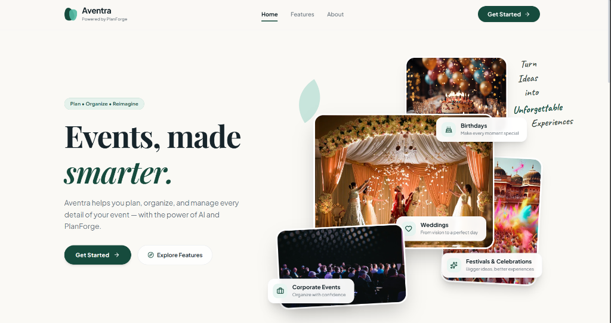
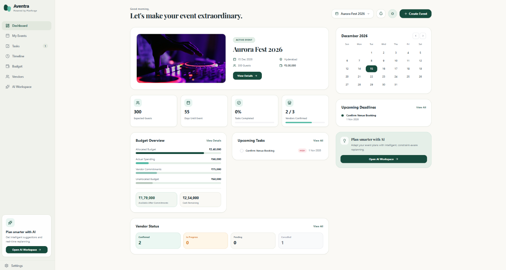
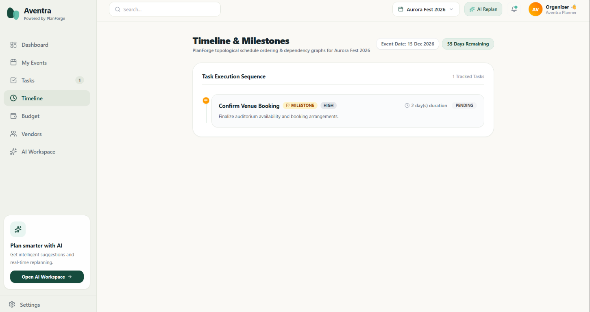
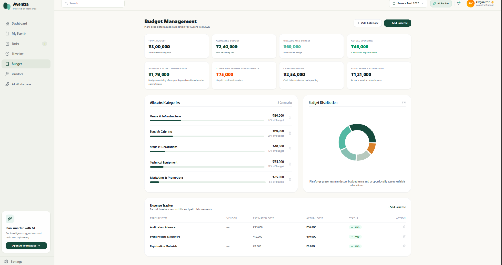
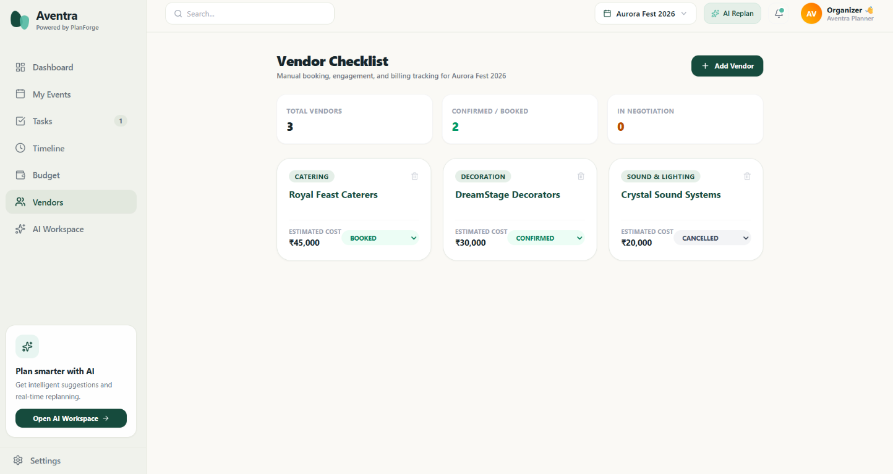
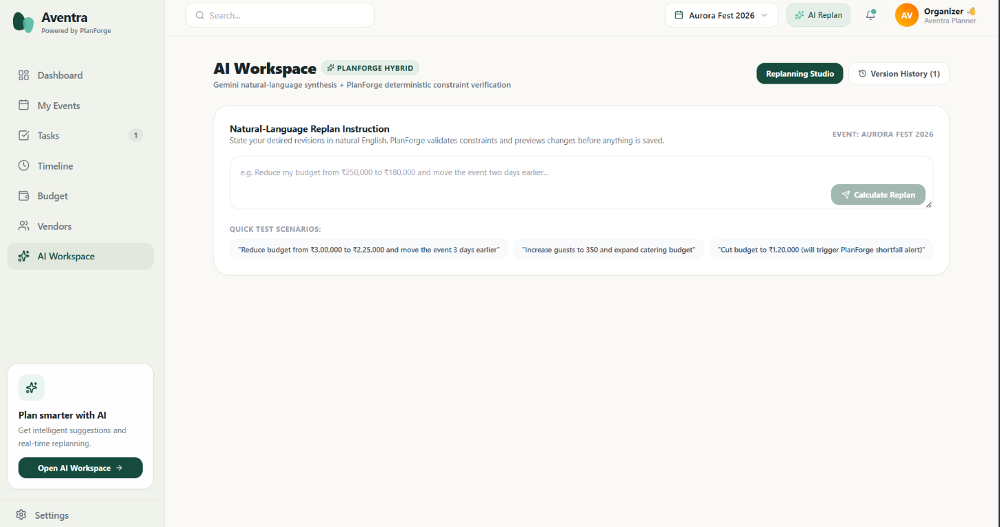
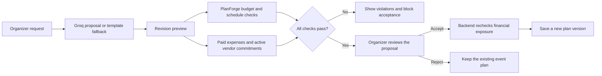
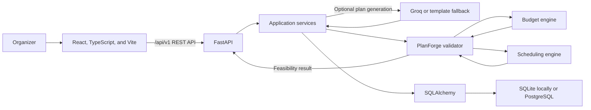

<div align="center">
  <h1>Aventra</h1>
  <p><strong>Powered by PlanForge</strong></p>
  <p><em>Every event, intelligently orchestrated.</em></p>
  <p>
    An event-planning workspace for turning event details into organized tasks, budgets, vendor records, and schedules—with deterministic checks before a revised plan is applied.
  </p>
  <p>
    
    
    
    
    
  </p>
</div>

## Product preview

The interface uses an understated cream, forest-green, and mint palette. These are screenshots of the application supplied for this project; they have been losslessly optimized for the repository.

<p align="center">
  
</p>
<p align="center"><em>Landing page · Aventra's event-planning workspace</em></p>

<table>
  <tr>
    <td width="50%" align="center">
      
      <br><strong>Dashboard</strong>
    </td>
    <td width="50%" align="center">
      
      <br><strong>Timeline &amp; milestones</strong>
    </td>
  </tr>
  <tr>
    <td width="50%" align="center">
      
      <br><strong>Budget management</strong>
    </td>
    <td width="50%" align="center">
      
      <br><strong>Vendor checklist</strong>
    </td>
  </tr>
</table>

<p align="center">
  
</p>
<p align="center"><em>AI Workspace · preview a proposed revision before deciding whether to apply it</em></p>

The **My Events** and **Tasks** pages are implemented, but screenshots for those pages were not supplied and are not represented here.

## Why Aventra?

Planning an event means coordinating dates, people, tasks, costs, and vendors—often across separate tools. Aventra brings those records into one event workspace. It helps organizers track what is planned and committed, while **PlanForge** checks budget and schedule constraints instead of leaving feasibility entirely to a language model.

## What is implemented

- **Event creation and management** — create, view, update, and delete events; capture event details and generate a proposed baseline plan. Groq-powered generation is optional; a deterministic template fallback is available without it.
- **Dashboard and My Events** — review event information and navigate between events and planning areas.
- **Task management** — create and update tasks, including status, duration, deadlines, priorities, milestones, assignees, and dependencies.
- **Timeline** — inspect task ordering, milestone status, dependencies, and schedule conflicts.
- **Budget management** — manage budget categories and line-item expenses, including estimated and actual costs and payment status.
- **Vendor checklist** — manually track vendor details, estimated costs, and booking status. This is an organizer-maintained checklist, not a vendor marketplace or matching system.
- **AI-assisted replanning** — request proposed budget, date, or guest-count changes in natural language; review a preview and feasibility details; then accept or reject.
- **Plan history** — accepted revisions are saved as plan versions with feasibility details and a change summary.
- **Constraint-aware acceptance** — infeasible previews are blocked, and the backend acceptance endpoint independently rechecks existing financial exposure before applying a revision.

## PlanForge: deterministic checks around proposed plans

PlanForge is Aventra's Python constraint-validation layer. Groq can interpret a planning request and return a structured proposal; PlanForge evaluates applicable budget and schedule conditions before that proposal is presented for acceptance.

### Implemented checks

| Area | What is checked |
| --- | --- |
| Budget allocations | Allocations are evaluated against the total budget. Mandatory and fixed items are preserved; variable allocations may be scaled within the available amount. Infeasible mandatory/fixed requirements report a shortfall. |
| Task scheduling | Task dependencies are ordered topologically. Circular dependencies, impossible task deadlines, and tasks that finish after the event date are reported as schedule conflicts. |
| Existing financial exposure during replanning | The proposed budget must cover paid expenses and estimated costs for vendors in `booked` or `confirmed` status. Other vendor statuses, including `cancelled`, are excluded from active commitments. |
| Revision acceptance | A preview marked infeasible cannot be accepted. Acceptance checks financial exposure again on the backend; event data is only updated for an accepted revision. |

**Guest-count limitation:** guest count can be included in a revision preview and applied when accepted, but Aventra does not currently validate guest count against venue capacity, catering limits, or another guest-count constraint. Passing the implemented checks is not a guarantee that every real-world event requirement is satisfied.

### Replanning workflow



## How it works

1. **Create an event** and enter its planning details.
2. **Organize the plan** by managing tasks, dependencies, budget categories, expenses, vendors, and schedule.
3. **Request a revision** in the AI Workspace, such as a budget or date change.
4. **Review the preview** and the deterministic PlanForge feasibility result.
5. **Accept or reject** the proposal. Infeasible revisions are blocked; accepted revisions are saved as a new plan version.

## System architecture



The frontend uses the `/api/v1` API. FastAPI routes delegate to application services and SQLAlchemy models. PlanForge performs deterministic validation in the backend; Groq is an optional proposal-generation service, not the source of feasibility decisions.

## Technology

| Layer | Technologies |
| --- | --- |
| Frontend | React 19, TypeScript, Vite, Tailwind CSS v4, React Router, Recharts, Lucide |
| Backend | Python, FastAPI, Pydantic, SQLAlchemy |
| Planning | PlanForge budget and scheduling validators, Google OR-Tools |
| Database | SQLite for local development; PostgreSQL through psycopg when `DATABASE_URL` is configured |
| AI | Groq API using the official Python SDK; deterministic template fallback |
| Testing | Pytest, FastAPI TestClient |
| Deployment configuration | Vercel frontend, Render web service, Neon PostgreSQL — prepared, not deployed |

## Getting started

### Prerequisites

- Python 3.10 or newer
- Node.js 20.19+ or 22.12+ and npm (Vite 8-compatible versions)

### 1. Clone the repository

```bash
git clone https://github.com/sruthi-r-22/aventra.git
cd aventra
```

### 2. Set up the backend

Create and activate a virtual environment, then install the backend requirements:

```bash
cd backend
python -m venv .venv
```

PowerShell:

```powershell
.\.venv\Scripts\Activate.ps1
python -m pip install -r requirements.txt
Copy-Item ..\.env.example .env
```

macOS/Linux:

```bash
source .venv/bin/activate
python -m pip install -r requirements.txt
cp ../.env.example .env
```

Edit `backend/.env` only if needed. It contains placeholders, not credentials:

```dotenv
GROQ_API_KEY=your_groq_api_key_here
DATABASE_URL=sqlite:///./aventra.db
CORS_ORIGINS=http://localhost:5173,http://localhost:3000
```

The backend defaults to SQLite, creating `backend/aventra.db` when run from the `backend` directory. If `GROQ_API_KEY` is not configured, planning uses the deterministic fallback templates. Never commit `.env` or real credentials.

Start the API from `backend/`:

```bash
python -m uvicorn app.main:app --host 127.0.0.1 --port 8000 --reload
```

- API documentation: <http://localhost:8000/api/docs>
- Health check: <http://localhost:8000/api/health>

### 3. Set up the frontend

In a second terminal, from the repository root:

```bash
cd frontend
npm ci
npm run dev
```

Open <http://localhost:5173>. For local development, leave `VITE_API_URL` unset or blank; Vite's existing `/api` proxy targets the local backend. For a separate backend origin, set `VITE_API_URL` to the origin only; the client appends `/api/v1`.

## Testing and reliability

Run the backend automated tests from `backend/`:

```bash
python -m pytest tests/ -q
```

The current test files cover API behavior and replanning, PlanForge budget and scheduling constraints, and database URL/CORS deployment configuration:

- `backend/tests/test_api.py`
- `backend/tests/test_planforge.py`
- `backend/tests/test_deployment_config.py`

Run the frontend TypeScript check and production bundle from `frontend/`:

```bash
npm run build
```

PlanForge validation and the backend's acceptance checks are safeguards; they do not replace operational review of vendors, contracts, venue capacity, or other real-world requirements.

## Deployment status

Deployment configuration is prepared for **Vercel** (frontend), **Render Free Web Service** (FastAPI), and **Neon Free PostgreSQL**. **Aventra is not currently documented as deployed; no live demo URL is available.**

- `frontend/vercel.json` provides single-page-app route fallback. Configure Vercel with `frontend` as the project root and set `VITE_API_URL` to the Render service origin.
- `render.yaml` defines the backend root, build/start commands, free plan, health check, and environment-variable placeholders.
- Set `DATABASE_URL`, `GROQ_API_KEY`, and the allowed frontend origins in Render's environment settings. Do not put credentials in the repository.
- PostgreSQL URLs are normalized to use psycopg. SQLite remains the local default; initialization creates missing tables and only applies the existing compatibility-column change to SQLite.

Deployment still requires creating/configuring the provider services and entering your own secret values. See [Render configuration](./render.yaml), [Vercel configuration](./frontend/vercel.json), and the environment templates [`.env.example`](./.env.example) and [`frontend/.env.example`](./frontend/.env.example).

## Project structure

```text
aventra/
├── backend/
│   ├── app/
│   │   ├── api/                 # Events, budget, tasks, vendors, replanning
│   │   ├── models/              # SQLAlchemy models
│   │   ├── planforge/           # Budget, scheduling, unified validation
│   │   ├── schemas/             # API schemas
│   │   ├── services/            # Event, financial, and AI/replan services
│   │   ├── config.py
│   │   ├── database.py
│   │   └── main.py
│   ├── tests/
│   └── requirements.txt
├── docs/
│   └── images/                  # Supplied, optimized application screenshots
├── frontend/
│   ├── src/
│   │   ├── api/
│   │   ├── components/
│   │   ├── context/
│   │   └── pages/               # Landing, dashboard, events, tasks, budget,
│   │                            # timeline, vendors, AI Workspace
│   ├── .env.example
│   └── vercel.json
├── .env.example
├── README.md
└── render.yaml
```

## Limitations and next steps

- Guest-count revisions are supported, but guest counts are not checked against venue capacity or catering constraints.
- Vendor management is a manual checklist; discovery, ranking, booking, and vendor recommendations are not implemented.
- Pending replan previews are stored in process memory, so a backend restart invalidates outstanding preview tokens.
- Vercel/Render/Neon deployment is configured but still needs provider setup and credentials.
- Screenshots for **My Events** and **Tasks** are not included; only supplied screenshots are shown above.

## Hackathon context and acknowledgements

Aventra was prepared for **PromptWars Virtual Challenge 5: Celebration & Event Planner**. Vendor tracking is intentionally manual; the project does not implement vendor recommendations, ranking, or matching.

Built with the open-source communities behind React, FastAPI, SQLAlchemy, Google OR-Tools, and the other libraries listed above.
